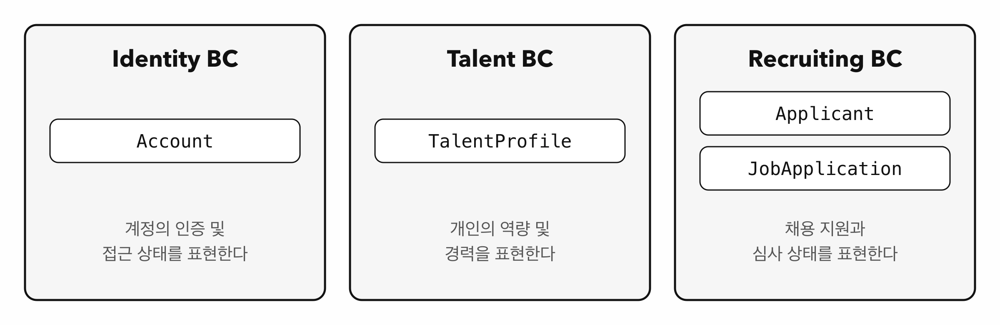
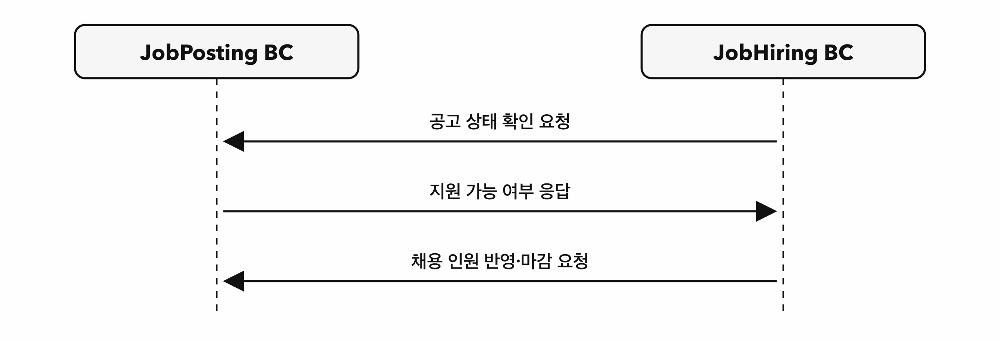
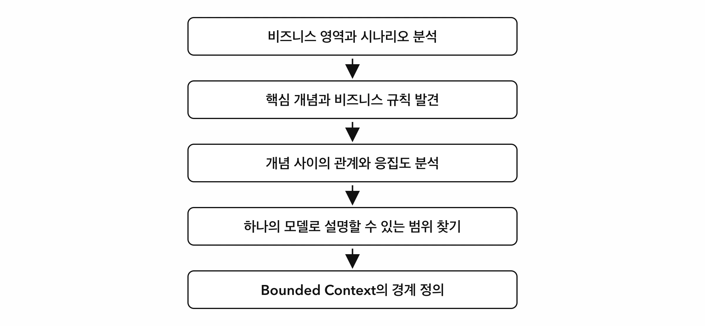
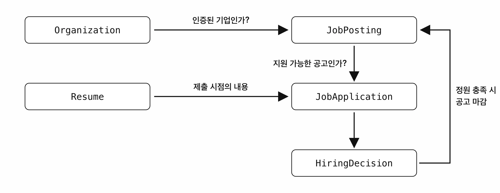
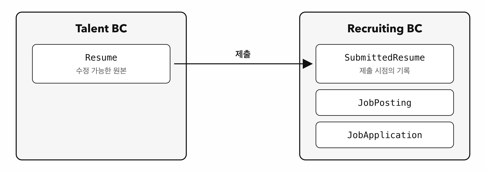
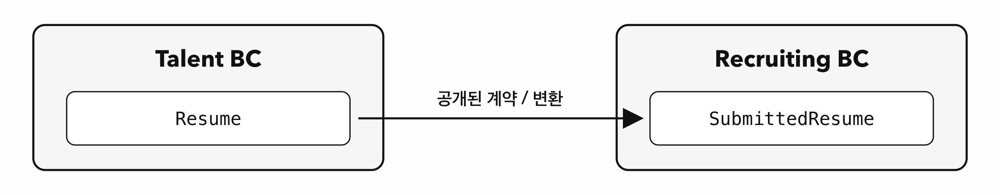

### 🌱 포스팅 작성 이유

Spring Boot와 Kotlin으로 Monorepo 기반 Multi-Module 프로젝트를 설계하면서 `individual-account`, `individual-talent-profile`, `corporation-job-posting`, `corporation-job-hiring` 같은 모듈을 고민했습니다.

처음에는 기능의 이름과 사용자 유형을 기준으로 나누면 될 것 같았습니다. 그런데 채용공고 등록과 지원자 심사를 별개의 Bounded Context(이하 BC)로 나누면, 지원할 수 있는 공고인지 확인하거나 채용 정원을 갱신할 때마다 두 모듈이 계속 서로를 불러야 합니다.

반대로 이력서 관리와 입사 지원은 같은 이력서 데이터를 다루지만, 이력서를 수정하는 규칙과 제출 당시의 내용을 보존하는 규칙이 다릅니다.

**기능이 비슷하다는 것과 같은 모델을 쓴다는 것은 다른 기준입니다.** 그렇다면 어떤 기능은 묶고 어떤 기능은 나누어야 할까요? 이 질문에 답하려면 먼저 다음을 생각해 봐야 합니다.

> **하나의 비즈니스 개념은 시스템 전체에서 언제나 같은 의미를 가져야 할까?**

BC가 무엇인지부터 실제로 경계를 긋는 과정까지 정리합니다.

---

## 1. Bounded Context를 이해하기 전에: Domain과 Domain Model

### 1.1 Domain은 소프트웨어가 해결하려는 문제 영역이다

**Domain(도메인)** 은 소프트웨어가 다루는 업무와 지식의 영역입니다. 쉽게 말해 "이 소프트웨어가 어떤 일을 돕는가"에 대한 답입니다.

채용 플랫폼이라면 인재 모집, 입사 지원, 기업 관리, 이력서 관리 같은 일들이 도메인을 이룹니다. 이것들은 아직 BC나 Gradle 모듈의 이름이 아닙니다. 코드 이전에, 비즈니스에서 어떤 일이 일어나는지를 말하는 것입니다.

### 1.2 Domain Model은 그 문제를 풀기 위해 만든 지도다

**Domain Model(도메인 모델)** 은 현실을 그대로 옮긴 것이 아니라, 문제를 푸는 데 필요한 것만 골라 정리한 것입니다.

지도를 떠올리면 쉽습니다. 지하철 노선도에는 역과 환승 정보만 있고 건물이나 산은 없습니다. 현실과 다르지만, 지하철을 타는 데는 그 편이 훨씬 쓸모 있습니다. 도메인 모델도 마찬가지로 **목적에 맞게 골라서 그린 지도**입니다.

예를 들어 채용공고를 `JobPosting`이라는 모델로 정리한다고 하겠습니다.

```text
JobPosting
├── 상태: DRAFT / OPEN / CLOSED
├── 모집 정원
├── 마감일
├── 게시한다
└── 지원을 받을 수 있는지 판단한다
```

중요한 것은 클래스나 필드의 개수가 아닙니다. 채용공고가 **어떤 상태를 가지고, 무엇을 할 수 있고, 어떤 규칙을 지켜야 하는가**를 담고 있다는 점입니다.

도메인 모델은 엔티티 클래스의 목록이 아닙니다. 개념 사이의 관계, 정책, 상태가 바뀌는 규칙, 업무에서 쓰는 용어까지 모두 모델에 포함됩니다. 클래스와 함수는 그 모델이 코드에 드러난 일부입니다.

---

## 2. 왜 하나의 모델로 전체 시스템을 표현하면 안 되는가

### 2.1 같은 사람도 어디서 보느냐에 따라 다른 개념이 된다

한 사람이 서비스에 가입하고, 이력서를 작성하고, 채용공고에 지원한다고 하겠습니다.

그 사람을 바라보는 관심사는 업무 영역마다 다릅니다.

| 관점 | 그 사람을 표현하는 개념 | 관심사 |
| --- | --- | --- |
| 계정 및 인증 | `Account` | 로그인할 수 있는가, 비밀번호, 계정 잠금, 탈퇴 |
| 인재 프로필 | `TalentProfile` | 경력, 기술, 자기소개, 포트폴리오 |
| 기업 관리 | `OrganizationMember` | 어느 기업 소속인가, 누가 초대했는가 |
| 채용 | `Applicant` | 어떤 공고에 지원했는가, 심사가 어디까지 진행됐는가 |

네 개념은 같은 사람을 가리키지만, **같은 도메인 모델은 아닙니다.** 지하철 노선도와 등산 지도가 같은 도시를 그렸어도 다른 지도인 것과 같습니다.

만약 모든 영역에서 함께 쓸 `User` 모델 하나만 만들면 어떻게 될까요?

```text
User
├── email
├── passwordHash
├── accountStatus
├── skills
├── portfolio
├── appliedJobs
└── hiringStatus
```

지하철 노선, 등산로, 땅의 소유 관계를 지도 한 장에 모두 그린 것과 같습니다. 구체적으로는 다음 문제가 생깁니다.

- `hiringStatus`는 지원한 적 없는 회원에게는 아무 의미가 없습니다.
- 채용 심사 정책이 바뀌면, 그와 무관한 로그인 쪽 코드까지 같은 클래스를 고치게 됩니다.
- "이 사용자가 활성 상태다"라는 말이 무엇을 뜻하는지 영역마다 달라집니다.

필드가 많아서 생기는 문제가 아닙니다. **목적이 서로 다른 영역의 용어와 규칙을 한 모델에 담으면, 그 모델이 무엇을 뜻하는지 일관되게 유지할 수 없다는 문제**입니다.

### 2.2 같은 단어가 서로 다른 뜻을 가질 수도 있다

`활성(Active)`이라는 단어를 예로 들겠습니다.

- 계정 영역에서 `활성`은 로그인할 수 있는 정상 계정이라는 뜻입니다.
- 인재 프로필 영역에서 `활성`은 구직 중이어서 기업에 프로필이 노출된다는 뜻입니다.

로그인은 되지만 구직은 쉬고 있는 사람이 있을 수 있습니다. 두 영역이 `Active`라는 상태 하나를 공유하면 이 사람을 표현할 수 없고, 한쪽 규칙을 다른 쪽에 잘못 적용하기 쉽습니다.

> DDD는 시스템 전체의 용어를 하나로 통일하려 하지 않습니다. 대신 **각 모델이 어디까지 유효한지를 분명하게 정합니다.**

---

## 3. Bounded Context란 무엇인가

**Bounded Context는 하나의 도메인 모델과 그 용어가 같은 뜻으로 통하는 범위입니다.** 지도로 치면 "이 지도는 여기서, 이 용도로 쓴다"고 정해 둔 것입니다.

이름을 풀어 보면 이해하기 쉽습니다.

- **Context(맥락)**: 어떤 단어와 규칙을 해석하는 배경입니다. `활성`이 무슨 뜻인지는 맥락이 정합니다.
- **Bounded(경계가 있는)**: 그 해석이 어디까지 통하는지 선을 그어 둡니다.

채용 플랫폼이라면 다음과 같이 경계를 그을 수 있습니다.



이 그림의 상자는 서버나 DB 한 대를 뜻하지 않습니다. **모델의 의미가 달라지는 지점**을 나타냅니다.

그렇다고 BC가 머릿속에만 있는 구분이라는 뜻은 아닙니다. Eric Evans는 경계를 팀 구성, 코드베이스, DB 스키마처럼 **눈에 보이는 형태로 명시하라**고 말합니다. 경계가 실제 코드와 팀에 드러나지 않으면 모델은 금세 다시 섞입니다.

순서를 정리하면 이렇습니다. 먼저 모델의 의미가 달라지는 지점을 찾고, 그다음 그 경계를 코드와 팀 구조에 드러냅니다. 모듈이나 서버를 먼저 나누고 거기에 BC라는 이름을 붙이는 것이 아닙니다.

### 3.1 경계 안에서는 모델의 의미가 하나여야 한다

`Recruiting`에서 `Applicant`가 '특정 공고에 지원한 사람'을 뜻한다면, 이 BC에서 나누는 대화와 설계, 코드에서 그 뜻이 흔들리지 않아야 합니다.

한 개발자는 `Applicant`를 '지원할 생각이 있는 모든 사용자'로 이해하고, 다른 개발자는 '실제로 지원서를 낸 사용자'로 이해한다면 두 사람은 같은 모델로 일하고 있지 않은 것입니다.

### 3.2 경계 밖에서는 다른 모델을 허용한다

반대로 `Talent`가 같은 사람을 `TalentProfile`로 표현한다고 해서 `Recruiting`의 모델을 고칠 필요는 없습니다. 두 BC는 같은 사람을 식별자(ID)로 연결하면서, 각자 목적에 맞는 모델을 따로 가집니다.

> BC를 나눈다는 것은 현실의 대상을 겹치지 않게 한 곳씩 배정하는 일이 아닙니다. **같은 대상을 맥락마다 다르게 모델링해도 된다고 허용하는 일**입니다.

### 3.3 BC는 기능·엔티티·모듈과 같지 않다

BC는 비슷해 보이는 여러 단위와 자주 혼동됩니다. 각각 답하는 질문이 다릅니다.

| 개념 | 답하는 질문 | 예시 |
| --- | --- | --- |
| 기능(Use Case) | 사용자는 무엇을 할 수 있는가? | 채용공고 등록 |
| 도메인 모델 | 비즈니스 개념과 규칙은 무엇인가? | 공고 상태, 지원 조건, 채용 정원 |
| Aggregate | 항상 함께 지켜져야 하는 규칙으로 묶인 객체는 어디까지인가? | `JobPosting` |
| Bounded Context | 이 모델과 언어가 어디까지 통하는가? | `Recruiting` |
| Gradle Module | 소스 코드와 빌드 의존성을 어디서 나누는가? | `:bounded-context:recruiting` |
| Microservice | 무엇을 독립적으로 배포하고 운영하는가? | `recruiting-service` |

BC 하나 안에는 여러 엔티티와 Aggregate가 있을 수 있습니다. `JobPosting`과 `JobApplication`을 별개의 Aggregate로 설계한다고 해서 BC도 둘로 나누어야 하는 것은 아닙니다. BC와 Gradle 모듈, 마이크로서비스가 반드시 1:1로 대응하는 것도 아닙니다.

---

## 4. Ubiquitous Language: BC 안에서 공유하는 언어

BC와 짝을 이루는 개념이 **Ubiquitous Language(보편 언어)** 입니다.

보편 언어는 업무를 잘 아는 사람(도메인 전문가)과 개발자가 함께 쓰는 공통 언어입니다. 회의에서 쓰는 단어, 요구사항 문서, 테스트 이름, 코드의 이름이 모두 같은 뜻을 가리키도록 맞춥니다.

예를 들어 채용 담당자가 다음처럼 말한다고 하겠습니다.

> 지원서가 접수되면 심사를 시작할 수 있지만, 철회된 지원서는 심사할 수 없습니다.

그런데 코드가 다음과 같다면 담당자의 말과 코드를 연결하기 어렵습니다.

<CodeTabs>

```java
// 무엇을 하는 코드인지 이름에 드러나지 않는다.
void process(Item item, boolean flag)
```

```kotlin
// 무엇을 하는 코드인지 이름에 드러나지 않는다.
fun process(item: Item, flag: Boolean)
```

```python
# 무엇을 하는 코드인지 이름에 드러나지 않는다.
def process(item: Item, flag: bool) -> None: ...
```

```javascript
// 무엇을 하는 코드인지 이름에 드러나지 않는다.
function process(item, flag) {}
```

</CodeTabs>

담당자가 쓰는 말을 그대로 코드에 옮기면 의도가 드러납니다.

<CodeTabs>

```java
// 심사를 시작해도 되는 상태인지는 도메인 코드에서 검증한다.
void startScreening(JobApplication application)
```

```kotlin
// 심사를 시작해도 되는 상태인지는 도메인 코드에서 검증한다.
fun startScreening(application: JobApplication)
```

```python
# 심사를 시작해도 되는 상태인지는 도메인 코드에서 검증한다.
def start_screening(application: JobApplication) -> None: ...
```

```javascript
// 심사를 시작해도 되는 상태인지는 도메인 코드에서 검증한다.
function startScreening(jobApplication) {}
```

</CodeTabs>

이름을 예쁘게 짓자는 이야기가 아닙니다. **업무에서 쓰는 말과 코드가 같은 모델을 가리키게 하자**는 것입니다.

보편 언어는 시스템 전체에서 하나일 필요가 없습니다. **BC 안에서** 일관되면 됩니다. 서로 다른 BC는 같은 단어를 다른 뜻으로 쓸 수도 있고, 같은 대상을 다른 이름으로 부를 수도 있습니다.

---

## 5. Subdomain과 Bounded Context는 무엇이 다른가

두 개념 모두 '영역'처럼 보이지만 답하는 질문이 다릅니다.

- **Subdomain**: 비즈니스를 어떤 하위 영역으로 나누어 이해할 것인가?
- **Bounded Context**: 소프트웨어에서 어떤 모델을 어디까지 적용할 것인가?

Vaughn Vernon은 이 차이를 문제 공간과 해법 공간으로 정리합니다. Subdomain은 풀어야 할 문제 쪽에, BC는 그 문제를 푸는 소프트웨어 쪽에 속합니다.

| 구분 | Subdomain | Bounded Context |
| --- | --- | --- |
| 관점 | 문제 공간(Problem Space) | 해법 공간(Solution Space) |
| 초점 | 비즈니스가 하는 일을 분류한다 | 모델을 정의하고 적용 범위를 정한다 |
| 결정 근거 | 비즈니스 목적과 경쟁력 | 언어, 모델, 규칙, 팀 구성과 시스템 제약 |
| 예시 | 인재 채용이라는 비즈니스 영역 | `Recruiting`이라는 모델 경계 |

Vernon은 **Subdomain 하나에 BC 하나가 대응하도록 맞추는 것을 바람직한 목표**로 봅니다. 새로 만드는 시스템이라면 이 방향으로 설계하는 것이 좋습니다. 다만 현실에서는 어긋나는 경우가 많습니다. 오래된 시스템 하나가 여러 Subdomain을 한꺼번에 떠안고 있거나, 팀 사정으로 하나의 Subdomain을 여러 BC가 나누어 맡기도 합니다. 그래서 두 개념을 구분해 두어야 지금 구조가 이상적인 모습에서 얼마나 벗어나 있는지 볼 수 있습니다.

Subdomain은 보통 **Core / Supporting / Generic** 으로 분류합니다. 어디에 가장 공을 들이고, 어디는 기성 솔루션을 써도 되는지를 판단하기 위한 분류입니다. Gradle 모듈이나 BC의 개수를 정하는 규칙은 아닙니다.

---

## 6. 기능을 기준으로 나누면 왜 문제가 되는가

이제 처음의 고민으로 돌아가겠습니다. 채용 기능을 다음처럼 나누었다고 하겠습니다.

```text
corporation-job-posting
└── 채용공고 등록·수정·마감

corporation-job-hiring
└── 지원서 접수·심사·최종 합격
```

겉으로는 책임이 분명해 보입니다. 그러나 요구사항을 조금만 구체화하면 두 영역에 걸친 규칙이 나타납니다.

- 마감된 채용공고에는 지원할 수 없습니다.
- 지원자가 있으면 공고의 일부 조건을 수정할 수 없습니다.
- 최종 채용 인원이 정원에 도달하면 공고를 마감해야 합니다.

이렇게 나눈 구조에서는 지원을 접수할 때마다 공고의 상태를 물어봐야 하고, 최종 합격을 처리할 때마다 공고의 정원과 상태를 다시 조정해 달라고 요청해야 합니다.



BC 사이에 호출이 있다는 것 자체는 잘못이 아닙니다. 따져 볼 것은 **함께 지켜야 할 규칙을 둘로 갈라놓은 비용이, 따로 변경할 수 있다는 이점보다 큰가**입니다.

호출이 잦다고 해서 반드시 하나의 BC라는 뜻도 아닙니다. 두 영역이 실제로 다른 업무 용어를 쓰고 각자의 책임을 가진다면 나누는 것이 맞을 수 있습니다. 그래서 호출 횟수보다 **모델의 의미와, 그 규칙을 누가 책임지는가**를 먼저 봐야 합니다.

---

## 7. 비즈니스 요구사항에서 BC를 도출하는 5단계

그렇다면 경계는 어떻게 찾을까요? 정해진 절차가 있는 것은 아닙니다. 다만 처음부터 BC 이름을 나열하기보다 다음 순서로 접근하면 근거를 가지고 경계를 그을 수 있습니다.



채용 서비스에 적용해 보겠습니다.

### 7.1 비즈니스 영역과 시나리오를 분석한다

가상의 요구사항입니다.

1. 사업자 인증을 완료한 기업만 채용공고를 등록할 수 있습니다.
2. 기업은 공고의 채용 정원과 마감일을 설정합니다.
3. 구직자는 공개된 채용공고에 이력서를 제출합니다.
4. 기업은 제출된 지원서를 심사합니다.
5. 최종 합격 인원이 정원에 도달하면 공고가 마감됩니다.
6. 구직자가 원본 이력서를 수정해도 이미 제출한 이력서는 바뀌지 않습니다.

이 단계에서는 코드를 만들거나 BC 이름을 정하지 않습니다. 어떤 일이 일어나고, 누가 그 일을 하며, 어떤 조건이 필요한지를 먼저 적습니다.

### 7.2 핵심 개념과 비즈니스 규칙을 발견한다

| 개념 후보 | 발견한 규칙 |
| --- | --- |
| `Organization` | 사업자 인증 상태를 관리한다 |
| `JobPosting` | 마감된 공고에는 지원할 수 없다 |
| `JobApplication` | 한 공고에 중복 지원할 수 없다 |
| `HiringDecision` | 채용 정원을 초과해 합격 처리할 수 없다 |
| `Resume` | 구직자는 자신의 원본 이력서를 수정할 수 있다 |
| `SubmittedResume` | 제출 당시의 이력서 내용은 보존해야 한다 |

같은 시나리오에 등장한다고 모두 하나의 모델이 되는 것은 아닙니다. 각 규칙을 누가 책임지고, 무엇을 지키려는 규칙인지 살펴봐야 합니다.

### 7.3 개념 사이의 관계와 응집도를 분석한다

응집도는 개념들이 서로 얼마나 강하게 엮여 있는가를 뜻합니다. 개념 사이의 관계를 그려 보면 다음과 같습니다.



여기서 두 종류의 관계가 보입니다.

**채용공고·지원·합격 처리**는 '채용 진행'이라는 하나의 목적 아래에서 함께 움직이고, 공고 상태와 정원에 관한 규칙을 공유합니다. 하나의 `Recruiting` 모델로 설명하는 것이 자연스럽습니다.

**기업 인증과 원본 이력서 관리**는 채용에 정보를 제공하지만, 채용과 상관없이 각자의 규칙에 따라 만들어지고 바뀝니다. 각각 `Organization`, `Talent`가 책임지는 편이 자연스럽습니다.

### 7.4 하나의 일관된 모델로 설명할 범위를 찾는다

각 후보에 다음 질문을 던집니다.

> 이 개념들은 같은 비즈니스 목적을 위해 함께 움직이며, 같은 용어와 규칙으로 자연스럽게 설명되는가?

이 질문으로 다음과 같은 모델 경계를 제안할 수 있습니다.

```text
Organization Model
└── Organization / Verification

Talent Model
└── Resume / Career / Portfolio

Recruiting Model
├── JobPosting
├── JobApplication
├── SubmittedResume
└── HiringDecision
```

`Recruiting`이 `Organization`의 인증 상태나 `Talent`의 원본 이력서를 참조한다고 해서, 그 모델까지 직접 소유해야 하는 것은 아닙니다.

### 7.5 BC의 경계를 정의한다

최초 후보는 다음과 같습니다.

```text
bounded-context/
├── organization/
├── talent/
└── recruiting/
```

이것이 유일한 정답은 아닙니다. 공고 게시와 채용 심사를 실제로 다른 조직이 맡고, 정책과 변경 주기도 따로 움직인다면 다시 나눌 수 있습니다.

중요한 점은 디렉터리 이름에서 출발하지 않고, **시나리오에서 찾은 모델과 규칙으로 경계를 도출했다**는 것입니다.

### 7.6 누가 그 언어로 말하는지도 함께 본다

경계를 가르는 기준은 요구사항 속의 규칙만이 아닙니다. Martin Fowler는 BC의 경계를 정하는 가장 큰 요인으로 **사람과 조직**을 꼽습니다. 모델은 사람들이 쓰는 언어이기도 하므로, 쓰는 말이 달라지는 곳에서 모델도 달라진다는 것입니다.

채용 플랫폼에서 구직자를 담당하는 팀은 '프로필 공개 범위', '이력서 완성도'를 이야기합니다. 기업의 채용 담당자를 상대하는 팀은 '서류 전형', '면접 단계', '합격 통보'를 이야기합니다. 두 팀이 같은 회의에서 `이력서`라고 말해도 한쪽은 원본을, 다른 쪽은 제출본을 떠올립니다. 이렇게 **말이 어긋나기 시작하는 지점**이 경계의 강한 후보입니다.

팀 구조는 경계를 유지하는 데에도 영향을 줍니다. 하나의 모델을 여러 팀이 함께 고치면 각자의 필요에 따라 뜻이 조금씩 갈라지기 쉽습니다. 모델마다 책임지는 팀이 분명해야 그 의미가 지켜집니다.

---

## 8. 경계를 판단하는 다섯 가지 사례

### 8.1 채용공고와 지원자 심사: 기능은 다르지만 묶을 수 있다

채용공고 게시, 지원서 접수, 서류 심사는 서로 다른 기능입니다. 그러나 지원 자격, 모집 상태, 채용 정원처럼 서로 이어진 규칙이 있습니다.

```text
Recruiting BC
├── JobPosting
├── JobApplication
└── HiringDecision
```

**판단**: 하나의 채용 모델로 일관되게 설명할 수 있으므로 묶는 쪽을 먼저 검토합니다. 단, 모델 안에서 Aggregate와 트랜잭션을 어디서 나눌지는 따로 설계해야 합니다.

### 8.2 채용공고와 프리랜서 공고: 기능은 비슷하지만 나눌 수 있다

두 기능 모두 공고를 등록하고 지원을 받습니다. 하지만 다음과 같은 차이가 있다고 하겠습니다.

| 구분 | 채용 | 프리랜서 프로젝트 |
| --- | --- | --- |
| 지원 수단 | 이력서 | 제안서·견적 |
| 진행 단계 | 서류 심사 → 면접 → 합격 | 제안 → 협상 → 계약 |
| 금액 | 연봉·급여 | 프로젝트 예산·대금 |
| 완료 조건 | 채용 확정 | 계약 체결 |

둘 다 `Posting`이라는 이름을 쓰더라도 진행 과정과 규칙은 다릅니다.

```text
Recruiting BC
└── JobPosting / JobApplication

FreelanceMarketplace BC
└── ProjectPosting / Proposal / Contract
```

**판단**: 공고를 등록·수정·삭제하는 화면이 비슷하다는 이유만으로 하나의 모델로 합치지 않습니다. 실제 규칙이 거의 같다면 합칠 수도 있지만, 이 가정에서는 나누는 것이 자연스럽습니다.

### 8.3 원본 이력서와 제출 이력서: 데이터는 같아 보여도 의미가 다르다

구직자가 이력서를 제출한 뒤 원본을 수정했다고 하겠습니다.

- `Talent`의 `Resume`은 현재의 경력 정보를 나타내므로 계속 수정할 수 있습니다.
- `Recruiting`의 `SubmittedResume`은 지원 당시에 제출한 내용이므로 그 시점 그대로 보존해야 합니다.



**판단**: 정보의 출처가 같다고 같은 모델일 필요는 없습니다. 하나는 계속 수정되고 하나는 제출 후 고정되므로, 서로 다른 BC가 각자의 모델로 가집니다.

### 8.4 개인 계정과 기업 계정: 사용자 유형이 달라도 묶을 수 있다

개인회원과 기업 담당자가 같은 로그인·비밀번호·계정 잠금 규칙을 쓴다고 하겠습니다. 반면 기업의 사업자 검증과 소속 구성원 관리에는 별도의 규칙이 있습니다.

```text
Identity BC
└── Account / Credential / AccountStatus

Organization BC
└── Organization / OrganizationMember / Verification
```

**판단**: 사용자 유형마다 계정 BC를 따로 만들기보다, 공통된 계정 모델과 조직 모델로 책임을 나누는 편이 자연스럽습니다. 다만 개인과 기업의 인증 정책이 근본적으로 다르다면 다시 검토해야 합니다.

### 8.5 기업 피드와 채용공고: 게시하는 주체가 같아도 나눌 수 있다

기업 피드는 콘텐츠 공개·반응·수정 정책을 다룹니다. 채용공고는 지원 자격·모집 정원·채용 상태를 다룹니다.

```text
Community BC
└── FeedPost / FeedReaction

Recruiting BC
└── JobPosting / JobApplication
```

**판단**: 같은 기업이 화면에서 글을 올린다고 해서 같은 비즈니스 모델을 쓰는 것은 아닙니다. 책임과 바뀌는 이유가 다르므로 별도의 BC를 검토합니다.

### 8.6 다섯 사례 요약

| 사례 | 겉으로 보이는 공통점·차이 | 경계를 결정한 근거 | 후보 |
| --- | --- | --- | --- |
| 채용공고 + 심사 | 기능이 다르다 | 채용 과정의 규칙이 이어져 있다 | 통합 검토 |
| 채용공고 + 프리랜서 공고 | 기능이 비슷하다 | 목적·진행 과정·정책이 다르다 | 분리 검토 |
| 원본 + 제출 이력서 | 같은 정보를 쓴다 | 수정 가능 여부와 보존 규칙이 다르다 | 분리 검토 |
| 개인 + 기업 담당자 계정 | 사용자 유형이 다르다 | 인증 모델은 공통, 조직 관리는 별개다 | 책임별 재구성 |
| 기업 피드 + 채용공고 | 같은 기업이 게시한다 | 콘텐츠와 채용의 목적이 다르다 | 분리 검토 |

---

## 9. BC를 나눌 때 확인할 기준

지금까지의 내용을 질문으로 정리하면 다음과 같습니다.

| 확인할 질문 | 판단에 주는 의미 |
| --- | --- |
| 비즈니스 목적과 책임이 다른가? | 서로 다른 BC일 가능성이 있다 |
| 같은 용어가 서로 다른 뜻으로 쓰이는가? | 모델을 나눠야 한다는 강한 신호다 |
| 상태·진행 과정·정책이 다른가? | 서로 다른 모델을 가질 근거다 |
| 이 모델을 책임지는 팀은 어디이고, 그 팀은 어떤 말을 쓰는가? | 경계가 사람들이 실제로 쓰는 언어와 맞는지 본다 |
| 하나의 규칙을 지키려고 항상 함께 수정하는가? | 합치거나 경계를 조정할 것을 검토한다 |
| 나눈 뒤에 호출이 지나치게 많아지는가? | 경계를 너무 잘게 나눴는지 검토한다 |
| 서로 독립적으로 변경하고 테스트할 수 있는가? | 나눠서 얻는 이점이다 |

몇 개 이상 해당하면 무조건 나눈다는 공식은 없습니다. **용어와 모델의 일관성이 먼저**이고, 변경 독립성·정합성·운영 비용은 그 경계가 타당한지 검증하는 요소입니다.

경계는 한 번에 완벽하게 찾아지지도 않습니다. 업무를 아는 사람들과 이야기하고 새로운 규칙을 알게 되면서 계속 조정합니다.

### 9.1 함께 조회한다고 곧바로 합쳐야 하는 것은 아니다

`Recruiting`이 지원자 목록에 이름과 기술 스택을 함께 보여 준다고 하겠습니다. 이 정보는 `Talent`가 가지고 있습니다.

- 다른 BC의 테이블을 직접 JOIN하면 그 BC의 데이터 구조에 묶입니다.
- 대신 `Talent`가 공개한 조회 기능으로 여러 지원자의 정보를 한 번에 가져올 수 있습니다.
- 목록과 검색이 잦다면, 변경 이벤트를 받아 갱신하는 조회 전용 모델(Read Model)을 둘 수 있습니다.

조회 문제는 이런 방법으로 풀 수 있으므로, 함께 조회한다는 이유만으로 BC를 합칠 필요는 없습니다.

그러나 지원 가능 여부나 채용 정원 같은 **핵심 규칙을 검증할 때마다** 여러 BC의 상태를 맞춰야 한다면 이야기가 다릅니다. 그것은 조회 성능의 문제가 아니라 경계를 잘못 그은 문제일 수 있습니다.

정리하면, 함께 조회된다고 같은 BC는 아니지만 하나의 규칙을 지키기 위해 언제나 함께 바뀌어야 한다면 경계를 다시 살펴봐야 합니다.

---

## 10. BC 사이의 관계: Context Mapping

BC를 나눴다면 서로 어떻게 연동할지도 정해야 합니다.

`Recruiting`은 지원을 받는 시점에 `Talent`의 원본 이력서가 필요합니다. 이때 한쪽의 모델을 다른 쪽에 그대로 가져다 쓰지 않고, **두 모델이 어떤 관계이고 누가 변환을 책임지는지 정해 두는 것**이 중요합니다.



이렇게 BC 사이의 관계를 찾아 기록하는 일을 **Context Mapping**이라 하고, 그 결과물을 **Context Map**이라 합니다.

관계에는 여러 유형이 있습니다. 데이터를 제공하는 쪽과 가져다 쓰는 쪽으로 나누어 보면 대표적으로 다음과 같습니다.

- **Customer/Supplier**: 쓰는 쪽이 필요한 것을 요청하고, 제공하는 쪽이 이를 자기 계획에 반영한다. 두 팀이 협의할 수 있는 관계다.
- **Conformist**: 제공하는 쪽이 쓰는 쪽의 요구를 들어줄 이유가 없을 때, 쓰는 쪽이 상대의 모델을 그대로 따른다.
- **Anti-Corruption Layer(ACL)**: 쓰는 쪽이 중간에 변환 계층을 두어, 상대의 모델이 자기 모델 안으로 스며들지 않게 한다.

어떤 유형이 맞는지는 기술보다 두 팀의 관계에 달려 있습니다. 상대 팀과 협의할 수 있는지, 상대 모델을 그대로 받아도 괜찮은지에 따라 달라집니다.

---

## 11. 설계 결과를 Gradle 모듈로 옮기기

BC를 찾았다면 그다음에 코드 구조를 정합니다. Spring Boot 기반의 Modular Monolith라면 다음과 같이 시작할 수 있습니다.

```text
root/
├── apps/
│   └── api/                       # Spring Boot 실행·조립 모듈
│
└── bounded-context/
    ├── identity/                  # Gradle Module
    ├── organization/              # Gradle Module
    ├── talent/                    # Gradle Module
    │   └── src/main/kotlin/.../
    │       ├── domain/
    │       ├── application/
    │       └── adapter/
    ├── recruiting/                # Gradle Module
    │   └── src/main/kotlin/.../
    │       ├── domain/
    │       ├── application/
    │       └── adapter/
    ├── freelance-marketplace/     # Gradle Module
    └── community/                 # Gradle Module
```

하나의 예시 구조입니다. `domain`을 별도의 Gradle 모듈로 나누는 것이 잘못은 아니지만, 규모가 크지 않다면 BC를 Gradle 모듈로 만들고 그 안에서 `domain`, `application`, `adapter`를 패키지로 나누는 방식이 단순합니다.

모듈 사이에는 다음 원칙을 적용합니다.

- **코드 의존성**: 다른 BC의 도메인 엔티티나 Repository를 직접 가져다 쓰지 않습니다.
- **계약**: 각 BC가 공개한 인터페이스나 메시지를 통해서만 협력합니다.
- **데이터 소유권**: 다른 BC의 테이블을 직접 조회하거나 수정하지 않습니다. 자세한 내용은 [MSA를 지향한다면: 데이터베이스 소유권 설계](/blog/groups/cs/architecture/msa_database_ownership)에서 다뤘습니다.
- **배포**: 지금은 하나의 Spring Boot 프로세스로 실행하더라도 BC의 경계는 그대로 유지합니다.

Gradle 모듈, 패키지 접근 제한, 데이터 소유권은 BC의 경계를 코드에서 지키는 수단입니다. 다만 방향을 혼동하면 안 됩니다. **모듈을 나눴기 때문에 BC가 생기는 것이 아니라, BC를 찾았기 때문에 모듈을 나누는 것입니다.** BC 하나를 Gradle 모듈 하나에 대응시키는 것도 이번 설계에서 고른 구현 방식일 뿐, DDD가 강제하는 규칙은 아닙니다.

---

## 12. 마무리

BC를 나눌 때 처음 떠오르는 방법은 비슷한 기능끼리 묶는 것입니다. 그러나 '비슷한 기능을 어디에 모을까?'보다 다음 질문이 먼저입니다.

> **이 개념과 규칙은 어디까지 같은 뜻으로 통하고, 어디부터 다른 모델로 보아야 하는가?**

핵심 내용을 정리하면 다음과 같습니다.

- **Domain Model**은 문제를 푸는 데 필요한 개념과 규칙만 골라 정리한 지도입니다.
- **Bounded Context**는 하나의 모델이 같은 뜻으로 통하는 범위이며, 코드와 팀 구조에 명시적으로 드러나야 합니다.
- **Ubiquitous Language**는 그 경계 안에서 도메인 전문가와 개발자가 함께 쓰는 언어입니다.
- 기능이 달라도 하나의 모델을 이루면 같은 BC일 수 있고, 기능이 비슷해도 의미와 규칙이 다르면 다른 BC일 수 있습니다.
- 같은 대상을 가리키더라도 BC마다 다른 모델을 가질 수 있고, 그 관계는 **Context Mapping**으로 명시합니다.
- 경계는 규칙의 차이뿐 아니라 **사람들이 쓰는 말이 달라지는 지점**에서 드러납니다.
- BC는 디렉터리 이름에서 나오는 것이 아니라 비즈니스의 용어와 규칙에서 나옵니다.

**BC는 비슷한 기능을 모아 만든 묶음이 아니라, 하나의 도메인 모델이 의미와 규칙의 일관성을 지킬 수 있는 경계입니다.**

첫 설계에서 완벽한 경계를 찾아야 하는 것도 아닙니다. 새로 시작하는 프로젝트라면 지나치게 잘게 나누기보다 분명한 후보 경계로 시작하고, 실제 요구사항과 변경 패턴을 보면서 조정하는 편이 현실적입니다.

---

#### 📕 Reference

- Eric Evans, 『Domain-Driven Design: Tackling Complexity in the Heart of Software』, Chapter 2 "Communication and the Use of Language", Chapter 14 "Maintaining Model Integrity", Chapter 15 "Distillation"
- Eric Evans, [Domain-Driven Design Reference: Definitions and Pattern Summaries](https://www.domainlanguage.com/ddd/reference/)
- Vaughn Vernon, 『Implementing Domain-Driven Design』, Chapter 2 "Domains, Subdomains, and Bounded Contexts", Chapter 3 "Context Maps"
- Martin Fowler, [Bounded Context](https://martinfowler.com/bliki/BoundedContext.html)
- Microsoft Learn, [Use domain analysis to model microservices](https://learn.microsoft.com/en-us/azure/architecture/microservices/model/domain-analysis)
- Microsoft Learn, [Identify microservice boundaries](https://learn.microsoft.com/en-us/azure/architecture/microservices/model/microservice-boundaries)
