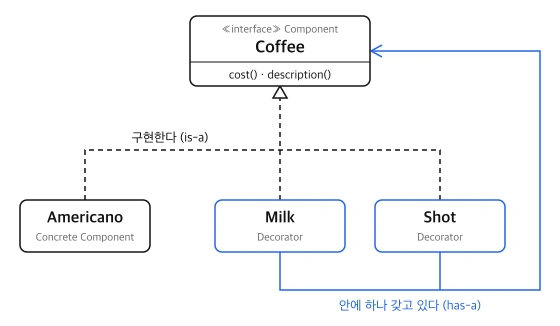
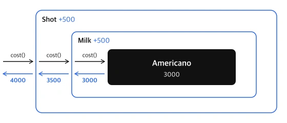

### 🌱 포스팅 작성 이유

기존 클래스에 기능을 추가하고 싶을 때 가장 먼저 떠오르는 방법은 상속입니다. 하지만 추가할 기능이 여러 개이고 서로 조합될 수 있다면 상속은 금방 감당하기 어려워집니다.

이 문제를 "상속하지 않고 감싼다"는 발상으로 푸는 데코레이터 패턴을 정리합니다.

---

## 1. 상속으로 기능을 조합할 때의 문제

카페 주문 시스템을 만든다고 가정하겠습니다. 아메리카노가 있고, 여기에 우유와 샷을 추가할 수 있습니다.

상속으로 풀면 조합마다 클래스가 하나씩 필요합니다.

```kotlin
open class Americano
class AmericanoWithMilk : Americano()
class AmericanoWithShot : Americano()
class AmericanoWithMilkAndShot : Americano()
```

옵션이 2개일 때 이미 4개입니다. 휘핑크림이 추가되면 8개, 시럽까지 추가되면 16개가 됩니다. 게다가 "샷 2번 추가"처럼 같은 옵션을 여러 번 넣는 경우는 표현할 방법이 없습니다.

| 옵션 수 | 필요한 클래스 수 |
| --- | --- |
| 2 | 4 |
| 3 | 8 |
| 4 | 16 |

원인은 상속이 **컴파일 시점에 고정되는 관계**이기 때문입니다. 조합은 주문할 때(실행 시점) 정해지는데, 상속은 그 조합을 전부 미리 클래스로 만들어 두라고 요구합니다.

---

## 2. 데코레이터 패턴이란

**데코레이터 패턴(Decorator Pattern)** 은 객체를 **같은 인터페이스를 가진 다른 객체로 감싸서** 기능을 덧붙이는 패턴입니다.<sup>[부록 1](#appendix-1)</sup>

"감싼다"는 비유적인 표현입니다. 코드로는 **"다른 객체를 프로퍼티로 갖고 있다가, 요청이 오면 그 객체에게 먼저 넘긴다"** 는 뜻입니다.

### 2.1 구성 요소

| 역할 | 설명 | 예시 |
| --- | --- | --- |
| Component | 감싼 것과 감싸인 것이 공유하는 인터페이스 | `Coffee` |
| Concrete Component | 기능이 덧붙여질 원본 객체 | `Americano` |
| Decorator | Component를 구현하면서, 안에 Component를 하나 갖고 있는 객체 | `Milk`, `Shot` |

### 2.2 객체 간 관계



그림에서 선은 두 종류입니다.

- **점선 (구현한다)**: `Americano`, `Milk`, `Shot` 모두 `Coffee`입니다. 정의의 "같은 인터페이스"가 이 선입니다.
- **파란 실선 (갖고 있다)**: `Milk`와 `Shot`만 안에 `Coffee`를 하나 갖고 있습니다. 정의의 "감싼다"가 이 선입니다. 특정 클래스가 아니라 `Coffee` 인터페이스를 가리키므로, 안에 든 것이 `Americano`든 다른 Decorator든 상관없습니다.

Decorator는 이 두 선을 **모두** 갖고 있습니다. 구현하기 때문에 원본 대신 쓸 수 있고, 갖고 있기 때문에 원본에게 일을 넘긴 뒤 자기 기능을 덧붙일 수 있습니다.

---

## 3. 구현

### 3.1 Component와 원본 객체

```kotlin
interface Coffee {
    fun cost(): Int
    fun description(): String
}

class Americano : Coffee {
    override fun cost() = 3000
    override fun description() = "아메리카노"
}
```

### 3.2 Decorator

```kotlin
class Milk(private val coffee: Coffee) : Coffee {
    override fun cost() = coffee.cost() + 500
    override fun description() = coffee.description() + " + 우유"
}

class Shot(private val coffee: Coffee) : Coffee {
    override fun cost() = coffee.cost() + 500
    override fun description() = coffee.description() + " + 샷"
}
```

`Milk`는 `Coffee`를 생성자로 받아 보관하고, 자신도 `Coffee`입니다. 가격을 물으면 안에 있는 커피에게 먼저 물어본 뒤 500원을 더해 대답합니다.

### 3.3 사용

이제 아메리카노를 우유로 감싸고, 그것을 다시 샷으로 감쌉니다.

```kotlin
val coffee: Coffee = Shot(Milk(Americano()))

println(coffee.description())   // 아메리카노 + 우유 + 샷
println(coffee.cost())          // 4000
```

`coffee.cost()`를 호출하면 바깥에서 안쪽으로 질문이 전달되고, 안쪽에서 바깥으로 답이 쌓여 나옵니다.



검은 화살표가 호출, 파란 화살표가 돌아오는 값입니다. `Shot`은 자기가 감싼 것이 `Milk`인지 `Americano`인지 알지 못하고, 그저 `Coffee`에게 가격을 물어볼 뿐입니다.

조합이 늘어나도 클래스는 늘어나지 않습니다. 감싸는 순서와 횟수만 바꾸면 됩니다.

```kotlin
Shot(Shot(Americano()))         // 샷 2번 추가: 4000
Milk(Americano())               // 우유만: 3500
```

1장에서 옵션 4개에 클래스 16개가 필요했던 것이, 여기서는 옵션 하나당 클래스 하나로 끝납니다.

---

## 4. Kotlin의 by로 전달 코드 줄이기

Decorator는 자기가 바꾸지 않는 메서드도 전부 안쪽 객체에게 전달해 줘야 합니다. 인터페이스의 메서드가 10개인데 그중 1개만 바꾸고 싶어도, 나머지 9개에 대해 "그대로 넘긴다"는 코드를 써야 합니다.

Kotlin은 `by` 키워드로 이 전달 코드를 자동으로 만들어 줍니다.

```kotlin
class Shot(private val coffee: Coffee) : Coffee by coffee {
    override fun cost() = coffee.cost() + 500
}
```

`Coffee by coffee`는 "`Coffee`의 모든 메서드를 `coffee`에게 그대로 넘겨라"라는 뜻입니다. 그중 바꾸고 싶은 것만 `override`하면 됩니다. 위 코드에서 `description()`은 직접 쓰지 않았지만 안쪽 커피의 것이 그대로 호출됩니다.

---

## 5. 이미 쓰고 있는 데코레이터

Java의 입출력 클래스가 대표적인 데코레이터 패턴입니다.

```kotlin
val reader = BufferedReader(InputStreamReader(FileInputStream("a.txt")))
```

| 객체 | 덧붙이는 기능 |
| --- | --- |
| `FileInputStream` | 파일에서 바이트를 읽는다 (원본) |
| `InputStreamReader` | 바이트를 문자로 변환한다 |
| `BufferedReader` | 버퍼에 모아 읽고, 줄 단위 읽기를 제공한다 |

생성자 안에 생성자가 겹겹이 들어가는 모양이 3.3의 `Shot(Milk(Americano()))`와 같습니다.

---

## 6. 장단점

| 구분 | 내용 |
| --- | --- |
| 장점 | 기존 클래스를 수정하지 않고 기능을 추가할 수 있다 |
| 장점 | 실행 시점에 기능을 자유롭게 조합할 수 있다 |
| 장점 | 기능 하나가 클래스 하나에 담겨 역할이 분명하다 |
| 단점 | 작은 클래스가 많아지고, 겹이 깊어지면 흐름을 따라가기 어렵다 |
| 단점 | 감싸는 순서에 따라 결과가 달라질 수 있다 |
| 단점 | 감싼 뒤에는 원본 타입이 가려진다 (`coffee is Americano`가 `false`) |

---

## 7. 마무리

데코레이터 패턴은 **"같은 인터페이스로 감싼다"** 는 한 가지 규칙으로 동작합니다. 감싼 객체도 원본과 같은 타입이므로 그 위를 또 감쌀 수 있고, 그래서 기능을 클래스 수의 폭발 없이 조합할 수 있습니다.

추가할 기능이 하나뿐이고 조합될 일이 없다면 상속으로 충분합니다. 기능이 여러 개이고 조합이 실행 시점에 정해진다면 데코레이터 패턴을 떠올리면 됩니다.

---

## 🌱 부록

### <span id="appendix-1">[1] "객체를 같은 인터페이스를 가진 다른 객체로 감싸서 기능을 덧붙이는 패턴" 풀어 읽기</span>

이 문장은 세 조각으로 나누어 읽을 수 있습니다.

> 객체를 / 같은 인터페이스를 가진 다른 객체로 감싸서 / 기능을 덧붙인다

커피 가격을 계산하는 코드를 예시로 하나씩 살펴보겠습니다.

```kotlin
interface Coffee {
    fun cost(): Int
    fun description(): String
}

class Americano : Coffee {
    override fun cost() = 3000
    override fun description() = "아메리카노"
}
```

#### "감싼다"는 안에 넣어 둔다는 뜻이다

```kotlin
class Milk(private val coffee: Coffee) : Coffee { /* ... */ }

val americano = Americano()
val milk = Milk(americano)    // milk 안에 americano를 넣어 둠
```

`Milk`는 생성자로 받은 커피를 자기 프로퍼티(`coffee`)에 보관합니다. 이 상태를 "`milk`가 `americano`를 감쌌다"고 부릅니다.

| 표현 | 가리키는 것 | 위 코드에서 |
| --- | --- | --- |
| 감싼 것 | 바깥. 다른 객체를 갖고 있는 쪽 | `milk` |
| 감싸인 것 | 안쪽. 들어 있는 쪽 | `americano` |

#### "기능을 덧붙인다"는 안쪽에 물어본 뒤 내 몫을 더한다는 뜻이다

```kotlin
class Milk(private val coffee: Coffee) : Coffee {
    override fun cost() = coffee.cost() + 500
    //                    ^^^^^^^^^^^^^   ^^^^^
    //                    안쪽에 물어봄     내 몫을 더함
    override fun description() = coffee.description() + " + 우유"
}
```

`milk.cost()`를 호출하면 `Milk`는 가격을 직접 계산하지 않습니다. 안에 든 `americano`에게 물어 3000을 받고, 거기에 500을 더해 3500이라고 답합니다.

`Americano` 클래스는 한 글자도 고치지 않았는데 "우유 추가" 기능이 붙었습니다. 이것이 "덧붙인다"의 의미입니다.

#### "같은 인터페이스"는 바깥 것도 여전히 Coffee라는 뜻이다

이 조건이 왜 필요한지는 없을 때와 비교하면 보입니다. 샷을 추가하는 `Shot`도 `Milk`와 같은 모양으로, `Coffee`를 받아 보관한다고 하겠습니다.

```kotlin
// ❌ Milk가 Coffee가 아닌 경우
class Milk(private val coffee: Coffee)          // ": Coffee"가 없다

val milk = Milk(Americano())
val shot = Shot(milk)     // 컴파일 에러: Shot은 Coffee를 받는데 milk는 Coffee가 아니다
```

```kotlin
// ✅ Milk도 Coffee인 경우
class Milk(private val coffee: Coffee) : Coffee

val milk = Milk(Americano())
val shot = Shot(milk)     // OK: milk도 Coffee이므로 또 넣을 수 있다
```

`Milk`가 `Coffee`이기 때문에 두 가지가 가능해집니다.

- **또 감쌀 수 있습니다.** `Shot`은 `Coffee`를 받으므로, `Milk`로 감싼 것도 그대로 넣을 수 있습니다. 그래서 몇 겹이든 겹칠 수 있습니다.
- **쓰는 쪽은 차이를 모릅니다.** `Coffee` 타입 변수에 `Americano()`가 들어 있든 `Shot(Milk(Americano()))`가 들어 있든, 똑같이 `cost()`만 부르면 됩니다.

#### 정의를 다시 읽으면

> 객체를 / 같은 인터페이스를 가진 다른 객체로 감싸서 / 기능을 덧붙인다

풀어 쓰면 다음과 같습니다.

**`Americano`를, 똑같이 `Coffee`인 `Milk` 안에 넣어 두고, `Milk`가 안쪽에 물어본 결과에 자기 몫을 더해 답하게 한다.**
