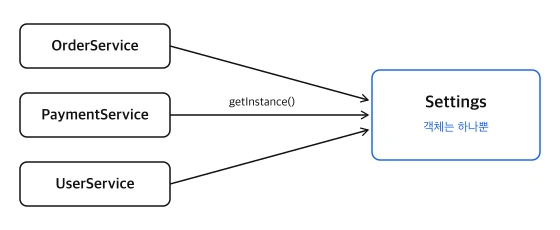

### 🌱 포스팅 작성 이유

Kotlin의 `object`를 정리하다 보니 그 바탕에 있는 싱글톤 패턴을 따로 다룰 필요가 생겼습니다. 싱글톤은 가장 단순해 보이는 디자인 패턴이지만, 제대로 구현하기는 생각보다 까다롭고 "쓰지 말아야 할 패턴"으로 자주 지목되기도 합니다.

무엇이고, 어떻게 만들며, 왜 조심해야 하는지를 정리합니다. 구현 방법의 차이가 잘 드러나도록 예시는 Java로 작성했습니다.

---

## 1. 싱글톤 패턴이란

**싱글톤 패턴(Singleton Pattern)** 은 어떤 클래스의 객체가 **프로그램 전체에서 단 하나만** 존재하도록 보장하는 패턴입니다. 다음 두 가지를 함께 제공합니다.

| 보장하는 것 | 의미 |
| --- | --- |
| 객체가 하나뿐이다 | 아무리 여러 번 요청해도 같은 객체를 돌려준다 |
| 어디서든 접근할 수 있다 | 그 객체를 얻는 정해진 방법(전역 접근점)이 있다 |



### 1.1 언제 쓰는가

객체가 여러 개 있으면 낭비이거나 문제가 되는 경우에 씁니다.

| 대상 | 하나여야 하는 이유 |
| --- | --- |
| 설정 정보 | 모든 곳이 같은 설정을 봐야 한다 |
| 커넥션 풀, 스레드 풀 | 한정된 자원을 한곳에서 관리해야 한다 |
| 캐시 | 여러 개면 저장한 곳과 찾는 곳이 달라진다 |
| 로거 | 같은 파일에 여러 객체가 따로 쓰면 내용이 섞인다 |

---

## 2. 기본 구조

객체를 하나로 제한하려면 세 가지가 필요합니다.

```java
public class Settings {

    private static final Settings INSTANCE = new Settings();    // ② 하나뿐인 객체를 보관

    private Settings() {}                                       // ① 밖에서 new 하지 못하게 막는다

    public static Settings getInstance() {                      // ③ 그 객체를 돌려준다
        return INSTANCE;
    }
}
```

| 요소 | 역할 |
| --- | --- |
| ① `private` 생성자 | 클래스 밖에서 `new Settings()`를 호출하지 못하게 막는다 |
| ② `static` 필드 | 하나뿐인 객체를 클래스가 직접 보관한다 |
| ③ `static` 메서드 | 보관한 객체를 돌려주는 유일한 통로다 |

```java
Settings a = Settings.getInstance();
Settings b = Settings.getInstance();

System.out.println(a == b);    // true

new Settings();                // ❌ 컴파일 에러: 생성자가 private이다
```

---

## 3. 구현 방법

차이는 **"객체를 언제 만드는가"** 와 **"여러 스레드가 동시에 요청해도 안전한가"** 두 가지에서 나옵니다.

### 3.1 이른 초기화 (Eager Initialization)

앞의 기본 구조 코드가 이 방식입니다. 클래스가 로딩될 때 객체를 미리 만들어 둡니다.

```java
private static final Settings INSTANCE = new Settings();
```

단순하고 스레드에 안전합니다. 다만 한 번도 쓰이지 않더라도 객체가 만들어집니다. 객체를 만드는 비용이 크지 않다면 이 방식으로 충분합니다.

### 3.2 늦은 초기화 (Lazy Initialization)

처음 요청받았을 때 만듭니다.

```java
private static Settings instance;

public static Settings getInstance() {
    if (instance == null) {            // 아직 없으면
        instance = new Settings();     // 만든다
    }
    return instance;
}
```

쓰일 때까지 객체를 만들지 않지만, **멀티스레드 환경에서는 싱글톤이 깨집니다.**

| 순서 | 스레드 A | 스레드 B |
| --- | --- | --- |
| 1 | `instance == null` 확인 → 참 | |
| 2 | | `instance == null` 확인 → 참 |
| 3 | `new Settings()` 실행 | |
| 4 | | `new Settings()` 실행 |

두 스레드가 모두 "아직 없다"고 판단하고 각자 객체를 만듭니다. 실제로 스레드 8개가 동시에 `getInstance()`를 호출하도록 실행해 보니 객체가 8개 만들어졌습니다.

### 3.3 synchronized

메서드에 락을 걸어 한 번에 한 스레드만 들어오게 합니다.

```java
public static synchronized Settings getInstance() {
    if (instance == null) {
        instance = new Settings();
    }
    return instance;
}
```

안전해지지만, 객체가 이미 만들어진 뒤에도 **호출할 때마다 락을 겁니다.** 락이 필요한 것은 처음 한 번뿐인데 매번 비용을 치르게 됩니다.

### 3.4 Double-Checked Locking

락을 걸기 전에 한 번, 건 뒤에 한 번, 두 번 확인합니다.

```java
private static volatile Settings instance;

public static Settings getInstance() {
    if (instance == null) {                      // 1차 확인: 락 없이
        synchronized (Settings.class) {
            if (instance == null) {              // 2차 확인: 락 안에서
                instance = new Settings();
            }
        }
    }
    return instance;
}
```

객체가 만들어진 뒤에는 1차 확인에서 바로 빠져나가므로 락을 걸지 않습니다. 단, 필드에 `volatile`을 반드시 붙여야 합니다. 없으면 다른 스레드가 아직 초기화가 끝나지 않은 객체를 볼 수 있습니다. 코드가 복잡하고 실수하기 쉽습니다.

### 3.5 Holder

객체를 내부 클래스에 담아 둡니다.

```java
public class Settings {

    private Settings() {}

    private static class Holder {
        private static final Settings INSTANCE = new Settings();
    }

    public static Settings getInstance() {
        return Holder.INSTANCE;
    }
}
```

Java는 클래스를 **처음 사용할 때** 로딩하고, 로딩은 한 번만 안전하게 이루어지도록 보장합니다. `Holder`는 `getInstance()`가 처음 불릴 때 로딩되므로, 락 없이도 늦은 초기화와 스레드 안전성을 모두 얻습니다. 늦은 초기화가 필요할 때 권장되는 방식입니다.

### 3.6 enum

```java
public enum Settings {
    INSTANCE;

    public String get(String key) { ... }
}

Settings.INSTANCE.get("api.url");
```

enum의 상수는 Java가 하나만 존재하도록 보장합니다. 가장 짧고, 다른 방식들이 막지 못하는 두 가지 우회로까지 막아 줍니다.

| 우회 방법 | 일반 클래스 싱글톤 | enum |
| --- | --- | --- |
| 리플렉션으로 `private` 생성자 호출 | 새 객체가 만들어진다 | 예외가 발생한다 |
| 직렬화했다가 역직렬화 | 새 객체가 만들어진다 | 같은 객체가 유지된다 |

리플렉션 부분은 직접 실행해 확인했습니다. 일반 클래스는 두 번째 객체가 만들어졌고, enum은 `IllegalArgumentException`이 발생했습니다.

### 3.7 비교

| 방식 | 만드는 시점 | 스레드 안전 | 특징 |
| --- | --- | --- | --- |
| 이른 초기화 | 클래스 로딩 시 | ✅ | 가장 단순하다 |
| 늦은 초기화 | 처음 요청 시 | ❌ | 멀티스레드에서 깨진다 |
| synchronized | 처음 요청 시 | ✅ | 매번 락을 건다 |
| Double-Checked Locking | 처음 요청 시 | ✅ | `volatile` 필수. 복잡하다 |
| Holder | 처음 요청 시 | ✅ | 락이 없다. 늦은 초기화에 권장 |
| enum | 클래스 로딩 시 | ✅ | 리플렉션과 직렬화에도 안전하다 |

### 3.8 Kotlin에서는

Kotlin은 언어 차원에서 싱글톤을 지원합니다.

```kotlin
object Settings {
    fun get(key: String): String = ...
}

Settings.get("api.url")
```

처음 사용할 때 만들어지고 스레드에 안전합니다. 자세한 내용은 [Kotlin의 object 글](/blog/kotlin/kotlin_object)에서 다뤘습니다.

---

## 4. 싱글톤은 빌려 쓰는 것이 아니다

### 4.1 여러 스레드가 동시에 사용한다

"한 스레드가 싱글톤을 쓰는 동안 다른 스레드는 기다려야 하는가"라는 의문이 들 수 있습니다. 그렇지 않습니다. 싱글톤에는 빌리고 반납한다는 개념이 없습니다.

`getInstance()`가 돌려주는 것은 객체 자체가 아니라 객체를 가리키는 **참조**입니다. 객체는 메모리에 하나 있고, 스레드마다 그 객체를 가리키는 참조를 하나씩 갖습니다. 참조는 몇 개든 만들 수 있으며, 누가 참조를 갖고 있다고 해서 다른 스레드가 막히지 않습니다.

```java
// 스레드 A, B, C가 같은 순간에 실행해도 서로 기다리지 않는다
String url = Settings.getInstance().get("api.url");
```

`synchronized`로 구현한 싱글톤도 마찬가지입니다. 그 락은 객체를 **얻는 순간**에만 걸리고, 얻은 뒤 객체를 사용하는 동안에는 아무 제한이 없습니다.

### 4.2 그래서 상태가 문제가 된다

여러 스레드가 동시에 쓴다는 것은, 싱글톤의 필드를 모든 스레드가 공유한다는 뜻입니다.

| 싱글톤의 상태 | 동시에 써도 되는가 |
| --- | --- |
| 필드가 없다 (기능만 있다) | 안전하다 |
| 필드가 있지만 바뀌지 않는다 | 안전하다 |
| 필드가 바뀐다 | 위험하다. 값이 꼬일 수 있다 |

```java
public class Counter {

    private static final Counter INSTANCE = new Counter();
    private Counter() {}
    public static Counter getInstance() { return INSTANCE; }

    private int count = 0;

    public void increase() { count++; }
    public int getCount() { return count; }
}
```

스레드 2개가 각각 `increase()`를 10만 번씩 호출하면 결과는 200,000이어야 합니다. 실제로 세 번 실행해 보니 110,101, 109,731, 107,683이 나왔습니다. `count++`는 "읽고, 더하고, 쓴다"의 세 단계이고, 두 스레드가 같은 값을 읽은 뒤 각자 쓰면 한 번의 증가가 사라지기 때문입니다.

싱글톤을 만들 때는 바뀌는 필드를 두지 않는 것이 기본이고, 꼭 필요하다면 그 필드에 대한 접근을 따로 보호해야 합니다.

### 4.3 싱글톤, 락, 풀의 차이

"반납해야 다른 스레드가 쓸 수 있다"는 동작은 싱글톤이 아니라 다른 장치의 것입니다.

| 장치 | 동작 |
| --- | --- |
| 싱글톤 | 객체가 하나일 뿐, 접근은 누구나 동시에 한다 |
| 락 (`synchronized`) | 한 스레드가 끝날 때까지 다른 스레드가 기다린다 |
| 풀 (커넥션 풀 등) | 하나를 빌려 가면 반납할 때까지 다른 스레드는 그것을 쓰지 못한다 |

커넥션 풀에는 두 가지가 함께 들어 있습니다. **풀 자체는 싱글톤**이라 모든 스레드가 동시에 접근하지만, 풀에서 꺼낸 **커넥션 하나하나는 빌려 쓰고 반납**합니다.

---

## 5. 싱글톤의 문제점

싱글톤은 편리하지만 남용하면 코드를 다루기 어렵게 만듭니다. 문제는 "객체가 하나"라는 점이 아니라 **"어디서든 접근할 수 있다"** 는 점에서 나옵니다.

### 5.1 전역 상태가 된다

싱글톤이 바뀔 수 있는 값을 갖고 있으면 프로그램 전체가 공유하는 전역 변수와 같습니다. 어느 코드든 값을 바꿀 수 있으므로, 값이 이상할 때 원인을 찾으려면 프로그램 전체를 뒤져야 합니다. ([불변 객체 글](/blog/programming_concept/immutable_object)의 "공유된 가변 상태" 참고)

### 5.2 의존 관계가 숨는다

```java
public class OrderService {

    public void order() {
        String url = Settings.getInstance().get("api.url");    // 메서드 안에서 몰래 가져다 쓴다
        ...
    }
}
```

`OrderService`의 생성자나 메서드 시그니처 어디에도 `Settings`가 나오지 않습니다. 코드 내부를 읽기 전에는 이 클래스가 `Settings`에 의존한다는 사실을 알 수 없습니다.

### 5.3 테스트하기 어렵다

- **바꿔 끼울 수 없습니다.** `OrderService`가 `Settings.getInstance()`를 직접 부르므로, 테스트에서 가짜 설정으로 교체할 방법이 없습니다.
- **테스트끼리 영향을 줍니다.** 싱글톤은 프로그램이 끝날 때까지 살아 있으므로, 한 테스트가 바꾼 값이 다음 테스트에 남습니다. 실행 순서에 따라 결과가 달라지는 테스트가 됩니다.

### 5.4 대안: 하나만 만들되, 넘겨받는다

문제의 원인은 사용하는 쪽이 `getInstance()`로 **직접 찾아가는 것**입니다. 필요한 객체를 밖에서 넘겨받도록 바꾸면 해결됩니다. 이것을 **의존성 주입(Dependency Injection)** 이라고 합니다.

```java
public class OrderService {

    private final Settings settings;

    public OrderService(Settings settings) {    // 필요한 것을 생성자로 받는다
        this.settings = settings;
    }

    public void order() {
        String url = settings.get("api.url");
        ...
    }
}
```

| | `getInstance()` 직접 호출 | 생성자로 주입 |
| --- | --- | --- |
| 의존 관계 | 코드 내부에 숨어 있다 | 생성자에 드러난다 |
| 테스트 | 교체할 수 없다 | 가짜 객체를 넘기면 된다 |
| 객체 수 | 하나 | 하나만 만들어서 여러 곳에 넘기면 역시 하나 |

Spring 같은 프레임워크가 이 방식을 씁니다. 객체를 하나만 만들어 필요한 곳에 넣어 주는 일을 프레임워크가 대신하므로, 클래스에 `private` 생성자나 `getInstance()`를 만들 필요가 없습니다. **"객체가 하나"라는 이점은 얻고, "어디서든 접근"이라는 문제는 피하는** 방법입니다.

---

## 6. 마무리

싱글톤 패턴은 객체를 하나로 제한하고 어디서든 접근할 수 있게 합니다. Java에서 구현할 때는 이른 초기화가 가장 단순하고, 늦은 초기화가 필요하면 Holder 방식, 리플렉션과 직렬화까지 막아야 하면 enum을 씁니다. Kotlin에서는 `object`가 이 일을 대신합니다.

다만 "어디서든 접근할 수 있다"는 편리함은 전역 상태, 숨은 의존 관계, 어려운 테스트라는 비용을 치릅니다. **객체를 하나만 두는 것과 그 객체에 아무 데서나 접근하게 하는 것은 별개의 문제입니다.** 하나만 만들어서 필요한 곳에 넘겨주는 방식으로도 싱글톤의 목적은 달성할 수 있습니다.

---

#### 📕 Reference

- Erich Gamma 외, 『GoF의 디자인 패턴』, Singleton
- Joshua Bloch, 『Effective Java』 3판, 아이템 3 "private 생성자나 열거 타입으로 싱글턴임을 보증하라", 아이템 83 "지연 초기화는 신중히 사용하라"
