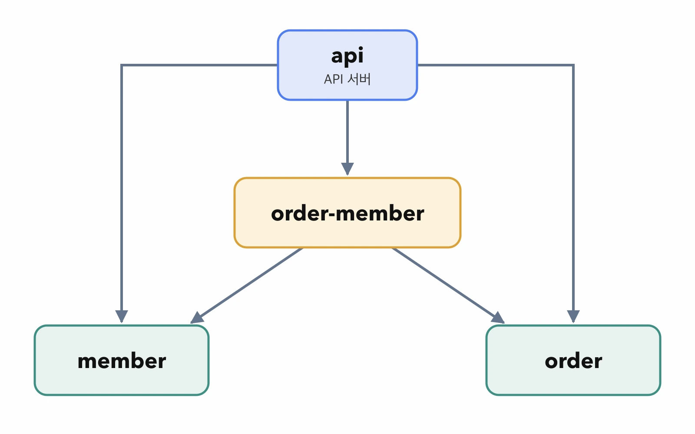

### 🌱 포스팅 작성 이유

멀티 모듈 프로젝트를 열면 `build.gradle.kts`는 모듈마다 하나씩 있는데, `settings.gradle.kts`는 루트에 딱 하나만 있습니다. 내용도 몇 줄뿐이라 지나치기 쉽지만, 이 파일이 없으면 Gradle은 모듈이 몇 개인지조차 알지 못합니다.

`settings.gradle.kts`가 무엇을 정하는 파일인지, `build.gradle.kts`와는 역할이 어떻게 나뉘는지를 Kotlin DSL 기준으로 정리합니다.

---

## 1. 예제 프로젝트

모듈 네 개로 이루어진 `commerce` 프로젝트를 예로 들겠습니다.

```text
commerce/
├── settings.gradle.kts          ← 빌드 전체에 하나
├── build.gradle.kts             ← 루트 프로젝트용
│
├── apps/
│   └── api/
│       └── build.gradle.kts     ← API 서버. 모든 모듈을 조립한다
│
├── contexts/
│   ├── member/
│   │   └── build.gradle.kts     ← 회원
│   └── order/
│       └── build.gradle.kts     ← 주문
│
└── integrations/
    └── order-member/
        └── build.gradle.kts     ← 주문과 회원을 잇는 모듈
```

Gradle 문서에서는 모듈을 **프로젝트(Project)** 라고 부릅니다. 맨 위 `commerce`가 루트 프로젝트(Root Project), 그 아래 모듈들이 서브 프로젝트(Subproject)입니다. 이 글에서는 익숙한 표현인 "모듈"을 서브 프로젝트와 같은 뜻으로 씁니다.

---

## 2. settings.gradle.kts와 build.gradle.kts의 차이

두 파일은 답하는 질문이 다릅니다. `settings.gradle.kts`는 "이 빌드는 **어떤 모듈들로 이루어져 있는가**"에, `build.gradle.kts`는 "이 모듈은 **어떻게 빌드하는가**"에 답합니다.

| 구분 | `settings.gradle.kts` | `build.gradle.kts` |
| --- | --- | --- |
| 개수 | 빌드 전체에 하나 | 모듈마다 하나 |
| 주요 역할 | 빌드에 참여할 모듈 결정 | 모듈별 빌드 설정 |
| 관리 대상 | 전체 프로젝트 구조 | 해당 모듈 |
| 모듈 등록 | `include()` | ❌ |
| 모듈 간 의존성 | ❌ | `implementation(project(...))` |
| 외부 라이브러리 | 저장소 등 공통 정책 설정 | 라이브러리 의존성 선언 |
| Gradle이 읽는 시점 | 초기화 단계 | 구성 단계 |

`settings.gradle.kts`는 출석부에 가깝습니다. 누가 이 빌드에 참여하는지를 적어 두는 곳이고, 각 참여자가 무슨 일을 하는지는 각자의 `build.gradle.kts`에 적습니다.

---

## 3. Gradle은 어떤 순서로 동작하는가

Gradle의 빌드 생명주기는 세 단계입니다.

| 단계 | 하는 일 | 읽는 파일 |
| --- | --- | --- |
| 초기화(Initialization) | 어떤 모듈들이 빌드에 참여하는지 확정한다 | `settings.gradle.kts` |
| 구성(Configuration) | 모듈마다 플러그인, 의존성, 태스크(Task)를 준비한다 | 각 모듈의 `build.gradle.kts` |
| 실행(Execution) | 요청받은 태스크와 그에 필요한 선행 태스크를 수행한다. `compileKotlin`, `test`, `jar` 등 | - |

예를 들어 다음 명령을 실행하면,

```bash
./gradlew :apps:api:build
```

Gradle은 이렇게 움직입니다.

1. `settings.gradle.kts`를 읽고 "모듈은 `api`, `member`, `order`, `order-member` 네 개"라고 파악합니다.
2. 각 모듈의 `build.gradle.kts`를 읽어 "`api`는 나머지 세 모듈에 의존한다"는 사실과 모듈별 태스크를 파악합니다.
3. `api`를 빌드하는 데 필요한 모듈부터 차례로 컴파일한 뒤, `api`의 `build` 태스크를 수행합니다.

설정 파일은 현재 폴더에서 먼저 찾고, 없으면 상위 폴더로 올라가며 찾습니다. 그래서 `commerce/apps/api` 폴더 안에서 명령을 실행해도 루트의 `settings.gradle.kts`를 찾아냅니다.

### 3.1 무엇이 모듈인지는 include가 정한다

폴더 안에 `build.gradle.kts`가 있으면 모듈이 된다고 생각하기 쉽지만, 그렇지 않습니다. Gradle이 모듈로 보는 기준은 하나뿐입니다.

> `settings.gradle.kts`의 `include`에 등록된 것만 모듈이다. (루트 프로젝트는 등록하지 않아도 항상 포함된다.)

`build.gradle.kts`는 모듈을 **만드는** 파일이 아니라, 이미 모듈로 정해진 폴더를 **어떻게 빌드할지 설명하는** 파일입니다. Gradle은 초기화 단계에서 모듈 목록을 먼저 확정하고, 그 목록에 있는 폴더의 `build.gradle.kts`만 찾아 읽습니다. 목록에 없는 폴더는 들여다보지도 않습니다.

경우를 나누어 보면 다음과 같습니다.

| `include`에 등록 | `build.gradle.kts` | Gradle이 보는 모습 |
| --- | --- | --- |
| ✅ | ✅ | 모듈이다. 일반적인 경우 |
| ✅ | ❌ | **모듈이다.** 다만 빌드 설정이 없어서 할 일이 없는 빈 모듈 |
| ❌ | ✅ | **모듈이 아니다.** 파일이 있어도 읽히지 않는다 |
| ❌ | ❌ | 평범한 폴더 |

예를 들어 `contexts/payment` 폴더를 만들고 그 안에 `build.gradle.kts`와 소스 코드까지 작성했지만 `include`에는 추가하지 않았다고 하겠습니다.

```text
contexts/
├── member/                  ← include에 등록됨 : 모듈
├── order/                   ← include에 등록됨 : 모듈
└── payment/                 ← 등록 안 됨 : Gradle에게는 없는 폴더
    ├── build.gradle.kts
    └── src/
```

이 상태에서는 다음과 같은 일이 벌어집니다.

- `./gradlew build`를 실행해도 `payment`의 코드는 컴파일되지 않고, 테스트도 실행되지 않습니다. 에러도 나지 않고 조용히 빠집니다.
- `./gradlew :contexts:payment:build`처럼 직접 가리키면 그런 프로젝트가 없다는 에러가 납니다.
- IDE도 `payment`를 모듈로 인식하지 않아 코드 자동 완성이나 `import`가 동작하지 않습니다.

`settings.gradle.kts`에 `":contexts:payment"` 한 줄을 추가하는 순간 `payment`는 모듈이 되고, 그때부터 그 안의 `build.gradle.kts`가 읽힙니다.

새 모듈을 만들었는데 IDE가 인식하지 못하거나 빌드에서 빠진다면, `build.gradle.kts`를 살펴보기 전에 `include`에 등록했는지부터 확인하면 됩니다.

---

## 4. 모듈 등록하기

`commerce`의 설정 파일은 다음과 같습니다.

```kotlin
// settings.gradle.kts
rootProject.name = "commerce"

include(
    ":apps:api",
    ":contexts:member",
    ":contexts:order",
    ":integrations:order-member",
)
```

### 4.1 rootProject.name

빌드의 이름을 정합니다. 적지 않으면 **루트 폴더의 이름**이 그대로 이름이 됩니다.

폴더 이름에 맡겨도 당장은 동작하지만, 같은 저장소를 다른 이름의 폴더로 내려받으면 프로젝트 이름도 달라집니다. CI 서버는 저장소를 임의의 폴더명으로 내려받는 경우가 많아서, 내 컴퓨터와 CI에서 이름이 달라질 수 있습니다. 항상 직접 적어 두는 편이 좋습니다.

### 4.2 include와 프로젝트 경로

`include(":apps:api")`는 "`apps/api` 폴더를 `:apps:api`라는 모듈로 빌드에 포함한다"는 뜻입니다.

콜론(`:`)은 Gradle의 **프로젝트 경로(Project Path)** 구분자입니다. 맨 앞의 콜론은 루트를 뜻하고, 파일 경로의 `/` 자리에 `:`을 쓴다고 생각하면 됩니다.

| Gradle 프로젝트 경로 | 실제 폴더 |
| --- | --- |
| `:apps:api` | `apps/api/` |
| `:contexts:member` | `contexts/member/` |
| `:contexts:order` | `contexts/order/` |
| `:integrations:order-member` | `integrations/order-member/` |

이 프로젝트 경로가 모듈의 이름표입니다. 다른 모듈에 의존할 때도, 특정 모듈의 태스크만 실행할 때도 이 경로로 모듈을 가리킵니다.

### 4.3 등록 결과 확인하기

루트에서 다음 명령을 실행하면 Gradle이 인식한 모듈 계층이 출력됩니다.

```text
$ ./gradlew projects

Root project 'commerce'
+--- Project ':apps'
|    \--- Project ':apps:api'
+--- Project ':contexts'
|    +--- Project ':contexts:member'
|    \--- Project ':contexts:order'
\--- Project ':integrations'
     \--- Project ':integrations:order-member'
```

등록하지 않은 `:apps`, `:contexts`, `:integrations`도 목록에 나타납니다. `:apps:api`를 등록하면 그 부모 경로인 `:apps`도 프로젝트로 함께 만들어지기 때문입니다. 이 셋은 `build.gradle.kts`가 없는데도 모듈로 잡힌 경우로, 모듈 여부를 정하는 것이 `build.gradle.kts`가 아니라 등록이라는 점을 보여 줍니다. 빌드 설정도 소스 코드도 없는 빈 모듈이므로 빌드 결과에는 영향이 없습니다.

`include()`는 모듈을 **등록**할 뿐입니다. 폴더나 `build.gradle.kts`, 소스 코드를 대신 만들어 주지는 않으므로 직접 만들어야 합니다.

---

## 5. 등록과 의존은 다른 이야기다

`settings.gradle.kts`에 네 모듈을 등록했다고 해서 모듈끼리 서로의 코드를 쓸 수 있게 되는 것은 아닙니다. 등록은 "이 모듈이 빌드에 참여한다"까지만 말해 줍니다. **어느 모듈이 어느 모듈의 코드를 쓰는지**는 각 모듈의 `build.gradle.kts`에 따로 적습니다.

```kotlin
// integrations/order-member/build.gradle.kts
dependencies {
    implementation(project(":contexts:member"))
    implementation(project(":contexts:order"))
}
```

```kotlin
// apps/api/build.gradle.kts
dependencies {
    implementation(project(":contexts:member"))
    implementation(project(":contexts:order"))
    implementation(project(":integrations:order-member"))
}
```

이제 Gradle이 인식하는 모듈 의존 관계는 다음과 같습니다.



`member`와 `order`는 같은 빌드에 등록되어 있지만 서로 의존하지 않으므로, `order`의 코드에서 `member`의 클래스를 `import`하면 컴파일 에러가 납니다.

즉 다음 두 줄은 전혀 다른 일을 합니다.

```kotlin
// settings.gradle.kts
include(":contexts:member")
// member를 이 빌드의 모듈로 등록한다
```

```kotlin
// apps/api/build.gradle.kts
implementation(project(":contexts:member"))
// api 모듈이 member 모듈의 코드를 쓰도록 연결한다
```

| | `include(...)` | `implementation(project(...))` |
| --- | --- | --- |
| 적는 곳 | `settings.gradle.kts` | 의존하는 쪽 모듈의 `build.gradle.kts` |
| 의미 | 이 모듈이 빌드에 존재한다 | 이 모듈이 저 모듈의 코드를 쓴다 |
| 빠뜨리면 | 모듈 자체가 무시된다 | 저 모듈의 클래스를 찾지 못해 컴파일 에러 |

두 설정은 순서 관계에 있습니다. `project(":contexts:member")`가 가리킬 수 있는 대상은 `include`로 등록된 모듈뿐이어서, 등록하지 않은 경로를 적으면 다음 에러가 납니다.

```text
Project with path ':contexts:member' could not be found in root project 'commerce'.
```

---

## 6. 루트에서 명령 한 번으로 전체를 다룬다

네 모듈을 한 빌드로 묶어 두면 얻는 가장 큰 이점입니다. 모듈 폴더에 하나씩 들어가 테스트를 네 번 돌릴 필요 없이, 루트에서 한 번만 실행하면 됩니다.

```bash
./gradlew test
```

### 6.1 내부에서 일어나는 일

1. **모듈 파악**: `settings.gradle.kts`를 읽고 관리할 모듈이 `api`, `member`, `order`, `order-member` 네 개임을 파악합니다.
2. **의존 순서대로 컴파일**: 모듈끼리 참조하는 순서에 맞춰 컴파일합니다.
   - 다른 모듈에 의존하지 않는 `:contexts:member`와 `:contexts:order`를 먼저 컴파일합니다.
   - 그다음 이 둘을 참조하는 `:integrations:order-member`를 컴파일합니다.
   - 마지막으로 모든 것을 조립하는 `:apps:api`를 컴파일합니다.
3. **전체 테스트 실행**: 각 모듈의 `src/test` 아래에 있는 테스트를 실행합니다.

컴파일 순서를 사람이 정해 준 적은 없습니다. Gradle이 각 모듈의 `build.gradle.kts`에 적힌 `project(...)` 의존성을 보고 스스로 계산합니다.

루트에서 `test`처럼 **경로 없이 태스크 이름만** 적으면, Gradle은 그 이름의 태스크를 가진 모든 모듈에서 실행합니다. `./gradlew build`, `./gradlew clean`도 같은 방식으로 전체 모듈에 적용됩니다.

한 가지 알아 둘 점은, 기본 동작에서는 어느 한 모듈의 테스트가 실패하면 빌드가 거기서 멈춘다는 것입니다. 실패가 있어도 나머지 모듈의 테스트까지 끝까지 돌려 결과를 한 번에 보고 싶다면 `--continue` 옵션을 붙입니다.

```bash
./gradlew test --continue
```

### 6.2 특정 모듈만 골라서 실행하기

`order` 모듈만 수정해서 빠르게 확인하고 싶다면, 태스크 이름 앞에 프로젝트 경로를 붙입니다.

```bash
./gradlew :contexts:order:test
```

이 경우에도 그 모듈이 의존하는 모듈은 알아서 먼저 컴파일됩니다. `./gradlew :integrations:order-member:test`를 실행하면 `member`와 `order`가 먼저 컴파일된 뒤 `order-member`의 테스트가 돌아갑니다.

| 명령 | 실행 범위 |
| --- | --- |
| `./gradlew test` | `test` 태스크를 가진 모든 모듈 |
| `./gradlew :contexts:order:test` | `order` 모듈 하나 (필요한 선행 컴파일 포함) |

### 6.3 바뀌지 않은 모듈은 다시 실행하지 않는다

`./gradlew test`를 한 번 더 실행해도 처음처럼 오래 걸리지 않습니다. Gradle은 태스크마다 입력(소스 코드, 의존성 등)과 출력을 기억해 두었다가, 입력이 그대로면 태스크를 건너뛰고 `UP-TO-DATE`로 표시합니다.

예를 들어 `order` 모듈의 코드만 고친 뒤 루트에서 `./gradlew test`를 실행하면 다음과 같이 됩니다.

| 모듈 | `order`에 의존하는가 | 결과 |
| --- | --- | --- |
| `:contexts:member` | 아니오 | 건너뜀 (`UP-TO-DATE`) |
| `:contexts:order` | 수정한 모듈 | 다시 컴파일하고 테스트 |
| `:integrations:order-member` | 예 | 다시 테스트 |
| `:apps:api` | 예 | 다시 테스트 |

수정한 모듈과 그 영향을 받는 모듈만 다시 처리되므로, 모듈을 잘 나눌수록 빌드가 빨라집니다.

"전체를 한 번에 실행"하는 것과 "특정 모듈만 골라서 실행"하는 것이 모두 가능한 이유는, `settings.gradle.kts`가 네 모듈을 하나의 빌드로 묶어 두었기 때문입니다.

---

## 7. 마무리

핵심은 세 문장입니다.

- `settings.gradle.kts`: 어떤 모듈들이 하나의 Gradle 빌드에 참여하는가
- `build.gradle.kts`: 이 모듈은 어떻게 빌드되고, 어떤 모듈과 라이브러리에 의존하는가
- `implementation(project(":..."))`: 이 모듈이 다른 모듈의 코드를 쓰도록 연결한다

`settings.gradle.kts`는 빌드에서 가장 먼저 읽히며, 여기에 `include`로 등록한 폴더만 모듈이 됩니다. 이렇게 한 빌드로 묶여 있기 때문에 루트에서 `./gradlew test` 한 번으로 전체 모듈을 의존 순서대로 빌드하고 테스트할 수 있고, 프로젝트 경로를 붙여 특정 모듈만 골라 실행할 수도 있습니다.

`settings.gradle.kts`에는 모듈 등록 외에 모든 모듈이 함께 따를 정책도 둘 수 있습니다. 모듈이 많아지면 이 설정들이 중요해집니다.

| 구문 | 정하는 것 |
| --- | --- |
| `pluginManagement` | 플러그인을 어느 저장소에서 받고, 어떤 버전을 쓸지 |
| `dependencyResolutionManagement` | 외부 라이브러리를 어느 저장소에서 받을지 |

모듈마다 반복되는 빌드 설정을 하나의 플러그인으로 묶는 방법은 [build-logic: 멀티 모듈의 공통 빌드 설정을 플러그인으로 관리한다](/blog/groups/server/gradle/build-logic_convention-plugins)에서 이어서 다룹니다.

---

#### 📕 Reference

- Gradle User Manual, [Settings File Basics](https://docs.gradle.org/current/userguide/settings_file_basics.html)
- Gradle User Manual, [Multi-Project Build Basics](https://docs.gradle.org/current/userguide/multi_project_builds.html)
- Gradle User Manual, [Build Lifecycle](https://docs.gradle.org/current/userguide/build_lifecycle.html)
- Gradle User Manual, [Incremental Build](https://docs.gradle.org/current/userguide/incremental_build.html)
- Gradle DSL Reference, [Settings](https://docs.gradle.org/current/dsl/org.gradle.api.initialization.Settings.html)
